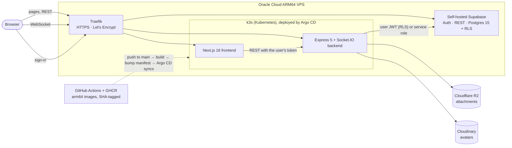

# Hibiki

A real-time chat app: direct messages and group chats, friend requests, invites with roles, and file sharing, wrapped in a pixel-art interface with light and dark themes.

It is also a complete, self-hosted deployment. The frontend and backend run on **Kubernetes (k3s)** and ship through **GitOps (Argo CD)**, and the database and auth run on a **self-hosted Supabase**, all on a single Oracle Cloud ARM64 VPS.

| | |
|---|---|
| **Live app** | https://hibiki.mrsdev.in |
| **API / Socket.IO** | https://backend-hibiki.mrsdev.in (`GET /` returns `Hibiki backend is alive`) |
| **Source** | https://github.com/Mars9563/hibiki |

## Features

- **Direct messages.** Send a friend request; when the other person accepts, a private 1:1 room is created.
- **Group chats.** Create a group, invite people, and let invitees see who is in it before they join. Admins edit the name, description and icon, and promote members to admin.
- **Real-time.** Messages, friend requests, invites and group edits arrive instantly over Socket.IO. Sends are optimistic: the message appears at once and is confirmed by the server.
- **File sharing.** Up to 10 files per message, 25 MB each: images, video, audio, PDF and documents, previewed inline. Thumbnails are generated for images and PDFs.
- **Profiles.** Name, username, status line and a cropped avatar.
- **History.** Cursor-based pagination, 50 messages per page, loading older messages as you scroll up.

## Architecture



- **Two paths from the browser.** REST goes through Next.js route handlers, which hold the session cookie and call the Express API with a bearer token. The WebSocket connects straight to the backend with the same Supabase JWT.
- **Authorization lives in the database.** The backend queries Supabase with the caller's own token, so Postgres Row Level Security applies. The few operations RLS deliberately forbids run through `SECURITY DEFINER` functions that only the backend's service role can call.
- **Files never touch disk.** Uploads are validated (type allow-list plus actual file signature), stored privately in R2, and read through short-lived signed URLs.

Details: [docs/ARCHITECTURE.md](docs/ARCHITECTURE.md).

## Tech stack

| Layer | Technology |
|---|---|
| Frontend | Next.js 16 (App Router), React 19, TypeScript, Tailwind CSS 4, shadcn/ui and Pixelact UI |
| Client state | Zustand with Immer, split into slices |
| Backend | Node 22, Express 5, Socket.IO 4, TypeScript, Zod, Multer, Sharp |
| Auth and database | Supabase (GoTrue, PostgREST, Postgres 15) with Row Level Security |
| Storage | Cloudflare R2 (attachments), Cloudinary (avatars) |
| Infrastructure | k3s, Argo CD, Traefik, Coolify, Docker (multi-stage, Alpine), GitHub Actions and GHCR |

## Engineering highlights

- **Least-privilege data access.** Row Level Security on every table, column-level and table-level grants matched to what the backend actually does, and atomic Postgres functions for multi-step operations (accepting a friendship creates the room and both participants in one transaction; sending a message with attachments is one transaction). → [docs/DATABASE.md](docs/DATABASE.md)
- **Security review with regression tests.** A review of the database, backend and deployment found and closed a set of authorization gaps. The fixes are SQL migrations with recovery scripts, and the repo includes a transaction-wrapped authorization test that is safe to run against production, plus tests for rate-limit and upload behaviour. → [docs/SECURITY.md](docs/SECURITY.md)
- **Upload pipeline.** MIME allow-list plus magic-byte verification, streaming size caps and concurrency limits so uploads cannot exhaust memory, image thumbnails, cleanup of stored objects on failure, and a decoding pixel cap against decompression bombs. → [docs/API.md](docs/API.md#post-apiroomsroomidmessages--multipart)
- **Real-time done carefully.** Per-user and per-room Socket.IO channels, optimistic sends reconciled with the server's copy, and per-user throttling. Rate limiting uses the real client IP, with spoofing resistance that is tested. → [docs/ARCHITECTURE.md](docs/ARCHITECTURE.md#sending-a-text-message)
- **Self-hosted GitOps delivery.** A push to `main` builds arm64 images, tags them with the commit SHA, commits the tag to `k8s/`, and Argo CD rolls it out behind readiness probes. Pods run non-root with read-only filesystems and memory limits. Removing a tunnel layer cut per-request overhead from about 500 ms to about 50 ms. → [docs/DEPLOYMENT.md](docs/DEPLOYMENT.md)

## Run it locally

You need Node 22 and a Supabase instance with the schema from [`supabase/migrations`](supabase/migrations) applied (the cloud product, a self-hosted one, or `npx supabase start` in `supabase/`). Attachments and avatars need a Cloudflare R2 bucket and a Cloudinary account.

```bash
# backend, http://localhost:5000
cd server && npm install && npm run dev

# frontend, http://localhost:3000 (second terminal)
cd client && npm install && npm run dev
```

Create `server/.env` and `client/.env.local` first. Every variable is listed in [server/README.md](server/README.md#environment-variables) and [client/README.md](client/README.md#environment-variables). A `docker-compose.yml` is also provided for running both containers locally.

## Documentation

| Document | Contents |
|---|---|
| [docs/ARCHITECTURE.md](docs/ARCHITECTURE.md) | System design, auth, message, friend and group flows, security model, known limitations |
| [docs/API.md](docs/API.md) | Every REST route and Socket.IO event, with shapes, rate limits and errors |
| [docs/DATABASE.md](docs/DATABASE.md) | ER diagram, enums, functions, RLS and privileges |
| [docs/DEPLOYMENT.md](docs/DEPLOYMENT.md) | Production topology, CI/CD, Kubernetes resources, runbook, hardening backlog |
| [docs/SECURITY.md](docs/SECURITY.md) | Controls, the October 2026 review, automated checks, residual risks |
| [client/README.md](client/README.md) · [server/README.md](server/README.md) · [supabase/README.md](supabase/README.md) | Per-package guides |

## Author

Mradul Raj Singh
