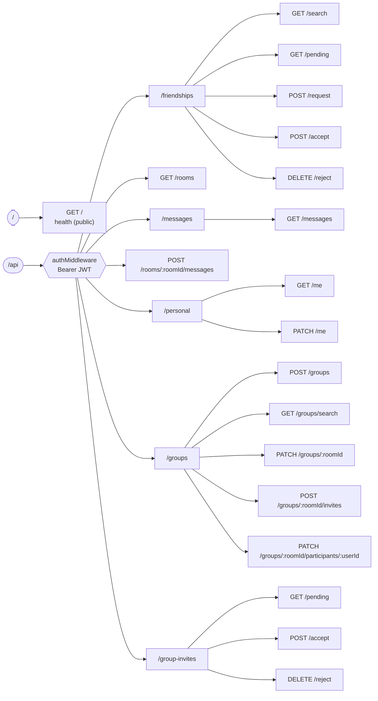

# API Reference

The backend is an Express 5 app with a Socket.IO server on the same HTTP port.

- **Production base URL:** `https://backend-hibiki.mrsdev.in`
- **Local base URL:** `http://localhost:5000`
- **Health check:** `GET /` → `200 Hibiki backend is alive` (no auth)

> **Calling it from the browser app?** The web client does not call these REST routes directly. It calls same-origin Next.js route handlers, which forward here. See [Next.js proxy map](#nextjs-proxy-map). Socket.IO is the exception and connects straight to the backend.

## Contents

- [Route map](#route-map)
- [Conventions](#conventions)
- [Rate limits](#rate-limits)
- [Friendships](#friendships)
- [Rooms and messages](#rooms-and-messages)
- [Profile](#profile)
- [Groups](#groups)
- [Socket.IO](#socketio)
- [Next.js proxy map](#nextjs-proxy-map)
- [Data shapes](#data-shapes)

---

## Route map



### At a glance

| Method | Path | Limiter | Purpose |
|---|---|---|---|
| `GET` | `/` | none | Health check |
| `GET` | `/api/friendships/search` | search | Find users to befriend |
| `GET` | `/api/friendships/pending` | default | Pending requests, sent and received |
| `POST` | `/api/friendships/request` | write | Send a friend request |
| `POST` | `/api/friendships/accept` | write | Accept a request (creates the direct room) |
| `DELETE` | `/api/friendships/reject` | write | Reject a request |
| `GET` | `/api/rooms` | default | All the caller's rooms (direct and group) |
| `GET` | `/api/messages` | default | One page of a room's messages |
| `POST` | `/api/rooms/:roomId/messages` | upload | Send a message with attachments |
| `GET` | `/api/personal/me` | default | The caller's profile |
| `PATCH` | `/api/personal/me` | write | Update name, username, status, avatar |
| `POST` | `/api/groups` | write | Create a group and invite people |
| `GET` | `/api/groups/search` | search | Find users to invite |
| `PATCH` | `/api/groups/:roomId` | write | Edit group name, description, icon (admin) |
| `POST` | `/api/groups/:roomId/invites` | write | Invite one user (admin) |
| `PATCH` | `/api/groups/:roomId/participants/:userId` | write | Change a member's role (admin) |
| `GET` | `/api/group-invites/pending` | default | Invites addressed to the caller |
| `POST` | `/api/group-invites/accept` | write | Accept an invite |
| `DELETE` | `/api/group-invites/reject` | write | Reject an invite |

"default" is the global `/api` limiter that applies to every route. See [Rate limits](#rate-limits).

---

## Conventions

**Authentication.** Every `/api/*` route requires (an unknown `/api/*` path therefore answers `401` rather than `404` when no valid token is sent):

```
Authorization: Bearer <Supabase access token>
```

The token is verified with Supabase (`auth.getUser`). Failures return `401`:

| Condition | Body |
|---|---|
| Header missing | `{ "message": "Unauthorized" }` |
| Not `Bearer …` | `{ "message": "Invalid authorization format" }` |
| Empty token | `{ "message": "Token missing" }` |
| Invalid or expired | `{ "message": "Invalid or expired token" }` |

**Response envelope.** Most routes respond with `{ "success": true, ... }` on success and `{ "success": false, "message": "..." }` on failure. Two routes (`GET /api/messages` and, partly, `GET /api/rooms`) use `error` instead of `message`, or give no message at all. They are marked below.

**Bodies.** JSON routes expect `Content-Type: application/json`. Routes marked *multipart* expect `multipart/form-data`.

**IDs.** All IDs are UUID strings.

**CORS.** Allowed origins are `http://localhost:3000` and the value of `ALLOWED_ORIGIN`, with credentials.

---

## Rate limits

All limiters use an in-memory store (single replica). Exceeding a limit returns `429` with the standard `RateLimit-*` headers and `{ "success": false, "message": "..." }`.

| Limiter | Window | Max | Key | Applied to |
|---|---|---|---|---|
| `defaultLimiter` | 15 min | 300 | real client IP | every `/api/*` request, **before** auth (stops floods of bad tokens from reaching Supabase) |
| `userLimiter` | 15 min | 900 | verified user ID | every `/api/*` request, **after** auth |
| `searchLimiter` | 1 min | 30 | user ID | `friendships/search`, `groups/search` |
| `writeLimiter` | 1 min | 20 | user ID | friend request, accept and reject; group create, edit, invite and role; invite accept and reject; profile update |
| `uploadLimiter` | 1 min | 10 | user ID | `POST /rooms/:roomId/messages` |
| Upload concurrency | n/a | 2 per user, 4 total | user ID | same route; excess gets `429` (per user) or `503` (global) with `Retry-After` |
| `message:send` throttle | 10 s | 20 | user ID (all tabs) | the socket event; excess gets `message:error` |

**Which IP?** The backend reads the client address from `X-Forwarded-For`, but only when the TCP peer is a private-network address (Traefik, the Next.js pod, the node). Traefik overwrites any value a client sends, and the Next.js route handlers forward it. A request from a public address cannot choose its own IP, and extra entries a client prepends are ignored because the right-most untrusted address wins. See [Architecture](ARCHITECTURE.md#two-network-paths-from-the-browser).

---

## Friendships

### `GET /api/friendships/search?q=<text>`

Find users whose username contains `q` (case-insensitive substring), **excluding yourself and anyone you already have a friendship row with** in either direction.

| | |
|---|---|
| Query | `q`: at least 2 characters after trimming. Shorter queries return an empty list. |
| Limit | 10 results |

```json
{
  "success": true,
  "results": [
    { "id": "…", "username": "mira", "full_name": "Mira K", "avatar_url": "https://res.cloudinary.com/…" }
  ]
}
```

### `GET /api/friendships/pending`

Pending requests where the caller is either side, newest first, with both profiles attached.

```json
{
  "success": true,
  "pending": [
    {
      "id": "…", "status": "pending", "created_at": "…",
      "requester_id": "…", "addressee_id": "…",
      "requester": { "id": "…", "username": "…", "full_name": "…", "avatar_url": "…" },
      "addressee": { "id": "…", "username": "…", "full_name": "…", "avatar_url": "…" }
    }
  ]
}
```

### `POST /api/friendships/request`

```json
{ "targetUserId": "<uuid>" }
```

| Status | Meaning |
|---|---|
| `201` | `{ success, message, friendship: { id, status, created_at, requester_id, addressee_id, requester, addressee } }` |
| `400` | `targetUserId` missing, or it is the caller |
| `404` | Target user does not exist |
| `409` | A friendship (pending or accepted) already exists in either direction |

**Emits:** `friendship:requested { to }` to the sender, `friendship:got_a_request { from }` to the target.

### `POST /api/friendships/accept`

The caller accepts a request that **`targetId` sent to them**.

```json
{ "targetId": "<requester uuid>" }
```

| Status | Meaning |
|---|---|
| `200` | `{ success: true, room }` where `room` is the `chat_rooms` row of the direct room (created, or reused if the pair already had one) |
| `400` | `targetId` missing, or equal to the caller |
| `404` | No pending request from that user |

**Emits:** `friendship:accepted { room }` to both users.

### `DELETE /api/friendships/reject`

The caller rejects a request that **`targetId` sent to them**. The row is deleted.

```json
{ "targetId": "<requester uuid>" }
```

| Status | Meaning |
|---|---|
| `200` | `{ success: true }` |
| `400` | `targetId` missing, or equal to the caller |
| `404` | No such pending request |

**Emits:** `friendship:rejected { by }` to the requester.

---

## Rooms and messages

### `GET /api/rooms`

Every room the caller participates in, direct and group, in one list discriminated by `roomType`.

```json
{
  "success": true,
  "rooms": [
    {
      "roomId": "…", "roomType": "direct",
      "currentUserId": "…", "otherUserId": "…",
      "otherUser": { "id": "…", "fullName": "…", "username": "…", "avatarUrl": "…", "status": "…" }
    },
    {
      "roomId": "…", "roomType": "group",
      "currentUserId": "…", "currentUserRole": "admin",
      "name": "Weekend plans", "avatarUrl": "…", "description": "…",
      "members": [
        { "id": "…", "username": "…", "fullName": "…", "avatarUrl": "…", "status": "…", "role": "admin" }
      ]
    }
  ]
}
```

On a server error this route returns `500 { "success": false }` and may omit `message`.

### `GET /api/messages`

One page of a room's history, **newest first**, with attachment URLs freshly signed.

| Query | Required | Default | Notes |
|---|---|---|---|
| `roomId` | yes | | The caller must be a participant |
| `limit` | no | 50 | Capped at 100 |
| `before` | no | none | ISO timestamp. Returns messages with `created_at` strictly older than this. Omit for the first page. |

To page backwards, pass the `created_at` of the **last** item in the previous response as `before`.

```json
{
  "success": true,
  "messages": [
    {
      "id": "…", "room_id": "…", "sender_id": "…",
      "created_at": "2026-07-05T10:15:30.123Z",
      "content": "hello", "message_type": "text",
      "attachments": []
    },
    {
      "id": "…", "message_type": "image", "content": "caption",
      "attachments": [
        {
          "id": "…", "fileName": "photo.jpg", "mimeType": "image/jpeg", "fileSize": 482113,
          "attachmentType": "image",
          "url": "https://<account>.r2.cloudflarestorage.com/…&X-Amz-Signature=…",
          "thumbnailUrl": "https://…"
        }
      ]
    }
  ]
}
```

| Status | Body |
|---|---|
| `400` | `{ success: false, error: "Missing roomId" }` |
| `403` | `{ success: false, error: "Forbidden" }` (not a participant) |
| `500` | `{ success: false, error: "…" }` |

Signed URLs expire after **1 hour**.

### `POST /api/rooms/:roomId/messages`  *(multipart)*

Create a message that has one or more files. **Text-only messages do not use this route.** Use the `message:send` socket event.

| Field | Type | Notes |
|---|---|---|
| `files` | file, repeated | 1 to 10 files. Max 25 MB each, max 75 MB total. |
| `content` | string, optional | Caption, max 65 536 characters |
| `clientTempId` | string, optional | Echoed back in the `message:new` event so the sender can replace its optimistic entry |

**Allowed types** (declared MIME and real file signature must agree):

| `attachmentType` | MIME types |
|---|---|
| `image` | `image/jpeg`, `image/png`, `image/gif`, `image/webp` |
| `video` | `video/mp4`, `video/webm`, `video/quicktime` |
| `audio` | `audio/mpeg`, `audio/wav`, `audio/ogg`, `audio/mp4`, `audio/webm` |
| `pdf` | `application/pdf` |
| `other` | `application/msword`, `…wordprocessingml.document` (docx), `application/vnd.ms-excel`, `…spreadsheetml.sheet` (xlsx), `application/zip`, `text/plain`, `text/csv` |

`text/plain` and `text/csv` have no magic bytes, so they are trusted on their declared type.

The message's `message_type` is the attachment type when all files share one, and `other` when they are mixed.

| Status | Meaning |
|---|---|
| `201` | `{ success: true, message }` where `message` has `attachments[]` with signed `url` and `thumbnailUrl` (images only) |
| `400` | No files, more than 10 files, too many multipart parts, malformed body, or caption too long |
| `403` | Not a member of the room |
| `413` | A file over 25 MB, or the request's total size over 75 MB (rejected from `Content-Length`, or cut off while streaming if the header is absent or wrong) |
| `415` | Declared type not allowed, or file content does not match its declared type |
| `429` | Rate limit hit, or the caller already has 2 uploads in progress (`Retry-After: 5`) |
| `502` | Upload to R2 failed (everything uploaded so far is deleted) |
| `503` | The server is already processing 4 uploads (`Retry-After: 5`) |
| `500` | Database write failed (uploads are deleted) |

All of these return the JSON envelope. Requests are processed in memory, so the guards run **before** any body is buffered; a request over the caps never occupies RAM. Requests must finish arriving within 2 minutes.

**Emits:** `message:new { message, clientTempId }` to everyone in the room, including the sender.

---

## Profile

### `GET /api/personal/me`

```json
{
  "success": true,
  "profile": {
    "id": "…", "username": "…", "full_name": "…", "status": "…",
    "created_at": "…", "updated_at": "…", "avatar_url": "https://res.cloudinary.com/…"
  }
}
```

`avatar_url` is a freshly signed Cloudinary URL, or `null`. `404` if the profile row is missing.

### `PATCH /api/personal/me`  *(multipart)*

Send any subset of fields. The avatar uploads first, so a failed upload never leaves the profile half-updated.

| Field | Rules |
|---|---|
| `fullName` | Non-empty after trim, max 255 |
| `username` | `^[_a-zA-Z][a-zA-Z0-9._]{2,19}$` (3 to 20 characters), unique |
| `status` | Max 150 characters (empty string clears it) |
| `avatar` | Image file, max 5 MB (the client crops it to a square JPEG first) |

| Status | Meaning |
|---|---|
| `200` | `{ success: true, profile }` |
| `400` | Validation failed, or no fields sent |
| `409` | Username already taken |
| `502` | Cloudinary upload failed |

---

## Groups

Admin-only routes return `403` for non-admins and non-members.

### `POST /api/groups`

Create a group. The caller becomes its only participant, as `admin`. Everyone in `inviteeIds` gets a **pending invite** (duplicates and the caller are dropped).

```json
{ "name": "Weekend plans", "inviteeIds": ["<uuid>", "<uuid>"] }
```

| Status | Meaning |
|---|---|
| `201` | `{ success: true, room, invites: [{ id, invitee_id }] }`. `room` is the enriched group shape from `GET /rooms`. |
| `400` | `name` missing or blank, or `inviteeIds` is not an array |
| `207` | Group was created but some invites failed. Body is `{ success: false, message }`. |

**Emits:** `group:invited { roomId, roomName, inviterId, inviteId }` to each invitee.

### `GET /api/groups/search?q=<text>`

Like friend search, but **does not exclude existing friends** (group invites are independent of friendship). Excludes only the caller. Same `q` rules and result shape as `friendships/search`.

### `PATCH /api/groups/:roomId`  *(multipart, admin)*

| Field | Rules |
|---|---|
| `name` | Non-empty after trim |
| `description` | Any string (trimmed) |
| `avatar` | Image file, max 5 MB |

Returns `200 { success: true, room }`, or `400` if nothing was sent.
**Emits:** `room:updated { room }` to everyone in the room.

### `POST /api/groups/:roomId/invites`  *(admin)*

```json
{ "inviteeId": "<uuid>" }
```

| Status | Meaning |
|---|---|
| `201` | `{ success: true, invite }` |
| `400` | `inviteeId` missing, or it is the caller |
| `403` | Not an admin |
| `409` | Already in the group, or already has a pending invite |

**Emits:** `group:invited { roomId, inviterId, inviteId }` to the invitee.

### `PATCH /api/groups/:roomId/participants/:userId`  *(admin)*

```json
{ "role": "admin" }
```

`role` must be `"admin"` or `"member"` (`400` otherwise). `404` if the target is not in the group. Returns `200 { success: true, room }`.
**Emits:** `room:updated { room }` to everyone in the room.

### `GET /api/group-invites/pending`

Invites addressed to the caller that are still pending, newest first. Each includes the group, the inviter, and the **roster** (members and pending invitees) so the caller can see who is in the group before deciding.

```json
{
  "success": true,
  "pending": [
    {
      "id": "…", "status": "pending", "created_at": "…",
      "room_id": "…", "inviter_id": "…", "invitee_id": "…",
      "room":    { "id": "…", "name": "…", "avatar_url": "…" },
      "inviter": { "id": "…", "username": "…", "full_name": "…", "avatar_url": "…" },
      "roster":  [ { "userId": "…", "username": "…", "fullName": "…", "avatarUrl": "…", "status": "accepted" } ]
    }
  ]
}
```

A roster entry's `status` is `accepted` (already a member) or `pending` (invited).

### `POST /api/group-invites/accept`

```json
{ "inviteId": "<uuid>" }
```

`200 { success: true, room }`, `400` for a missing `inviteId`, `404` if there is no such pending invite for the caller.
**Emits:** `group:memberJoined { roomId, userId }` to the room, and `group:joined { room }` to the new member.

### `DELETE /api/group-invites/reject`

```json
{ "inviteId": "<uuid>" }
```

`200 { success: true }`, `404` if there is no such pending invite. The invite row is **deleted**, so the admin can re-invite later.

---

## Socket.IO

**URL:** same host and port as the REST API. **Transport:** WebSocket, with HTTP long-polling fallback.

### Connecting

```js
import { io } from 'socket.io-client';

const socket = io('https://backend-hibiki.mrsdev.in', {
  withCredentials: true,
  auth: { token: supabaseAccessToken },
});
```

The token is verified in a connection middleware. Failures reject the handshake with `Unauthorized: No token found.`, `Unauthorized: Invalid token` or `Authentication failed.` (a `connect_error` on the client). On success the socket is automatically placed in a personal room named after the user's ID. CORS allows only `ALLOWED_ORIGIN`.

### Client → server

| Event | Payload | Behaviour |
|---|---|---|
| `room:join` | `{ roomId: string }` | Verifies membership, joins the Socket.IO room, replies with `room:joined`, or with `room:unauthorized` or `room:error` |
| `rooms:joinMany` | `{ roomIds: string[] }` | Joins every room the user is a member of and **silently ignores the rest**. No acknowledgement is sent. |
| `message:send` | `{ room_id: string, content: string, clientTempId: string }` | Trims the content (1 to 65 536 characters), enforces the 20-per-10-seconds throttle, inserts the message under the user's RLS, then broadcasts `message:new` to the room. Errors (including throttling) come back as `message:error`. |

### Server → client

| Event | Payload | Sent to | Trigger |
|---|---|---|---|
| `room:joined` | `{ success, message, roomId }` | the socket | Successful `room:join` |
| `room:unauthorized` | `{ success: false, error, roomId }` | the socket | `room:join` for a room the user is not in |
| `room:error` | `{ success: false, error }` | the socket | Bad payload or server error while joining |
| `message:new` | `{ message, clientTempId? }` | everyone in the room | A text or attachment message was stored |
| `message:error` | `{ error, clientTempId? }` | the sender's socket | `message:send` failed validation or the insert failed |
| `friendship:requested` | `{ to }` | the requester | `POST /friendships/request` |
| `friendship:got_a_request` | `{ from }` | the addressee | `POST /friendships/request` |
| `friendship:accepted` | `{ room }` | both users | `POST /friendships/accept` |
| `friendship:rejected` | `{ by }` | the requester | `DELETE /friendships/reject` |
| `group:invited` | `{ roomId, inviterId, inviteId, roomName? }` | the invitee | Group created or invite sent. `roomName` is only present on creation. |
| `group:joined` | `{ room }` | the new member | `POST /group-invites/accept` |
| `group:memberJoined` | `{ roomId, userId }` | everyone in the room | `POST /group-invites/accept` |
| `room:updated` | `{ room }` | everyone in the room | Group edit or role change |

The web client listens to all of these except `friendship:requested`, which it has no use for.

---

## Next.js proxy map

The browser calls these same-origin routes. Each one reads the Supabase cookie session, returns `401 { success: false, error: "Unauthorized" }` if there is none, and forwards to the backend with `Authorization: Bearer <access_token>`.

| Browser calls (Next.js) | Backend route | Notes |
|---|---|---|
| `GET /api/rooms` | `GET /api/rooms` | |
| `GET /api/messages?…` | `GET /api/messages?…` | query string passed through |
| `POST /api/rooms/[roomId]/messages` | `POST /api/rooms/:roomId/messages` | multipart passthrough, 25 MB body limit (`proxyClientMaxBodySize`) |
| `PATCH /api/personal/me` | `PATCH /api/personal/me` | multipart passthrough |
| `GET /api/friendships/search` | `GET /api/friendships/search` | |
| `GET /api/friendships/pending` | `GET /api/friendships/pending` | |
| `POST /api/friendships/request` | `POST /api/friendships/request` | |
| `POST /api/friendships/accept` | `POST /api/friendships/accept` | |
| `DELETE /api/friendships/reject` | `DELETE /api/friendships/reject` | |
| `POST /api/groups` | `POST /api/groups` | |
| `GET /api/groups/search` | `GET /api/groups/search` | |
| `PATCH /api/groups/[roomId]` | `PATCH /api/groups/:roomId` | multipart passthrough |
| `POST /api/groups/[roomId]/invites` | `POST /api/groups/:roomId/invites` | |
| `PATCH /api/groups/[roomId]/participants/[userId]` | `PATCH /api/groups/:roomId/participants/:userId` | |
| `GET /api/groups/invites/pending` | `GET /api/group-invites/pending` | **path differs** |
| `POST /api/groups/invites/accept` | `POST /api/group-invites/accept` | **path differs** |
| `DELETE /api/groups/invites/reject` | `DELETE /api/group-invites/reject` | **path differs** |

`GET /api/personal/me` has no proxy route. It is called server-side by the home page component during rendering.

---

## Data shapes

**Message** (`GET /messages`, `message:new`, upload response)

| Field | Type | Notes |
|---|---|---|
| `id` | uuid | |
| `room_id`, `sender_id` | uuid | |
| `created_at` | ISO timestamp | The pagination cursor |
| `content` | string or null | Null for attachment-only messages |
| `message_type` | `text` \| `image` \| `video` \| `audio` \| `pdf` \| `other` | |
| `attachments` | `Attachment[]` | Empty for text messages |

**Attachment**

| Field | Type |
|---|---|
| `id` | uuid |
| `fileName`, `mimeType` | string |
| `fileSize` | integer (bytes) |
| `attachmentType` | `image` \| `video` \| `audio` \| `pdf` \| `other` |
| `url` | presigned URL, valid 1 h |
| `thumbnailUrl` | presigned URL for a 400 px WebP, or `null`. Images only. Older images may lack the thumbnail object, in which case clients fall back to `url`. |

**Roles:** `admin` \| `member`. **Friendship / invite status:** `pending` \| `accepted` \| `rejected` (this is the shared `friendship_type` enum; rejection currently deletes the row, so `rejected` is never stored).
