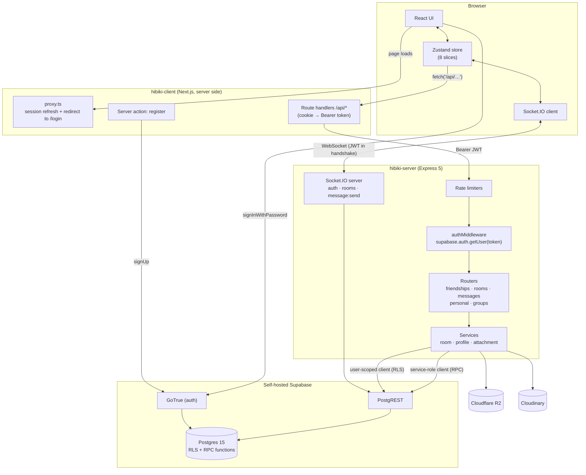
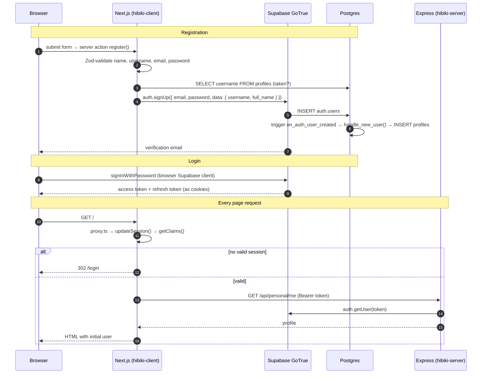
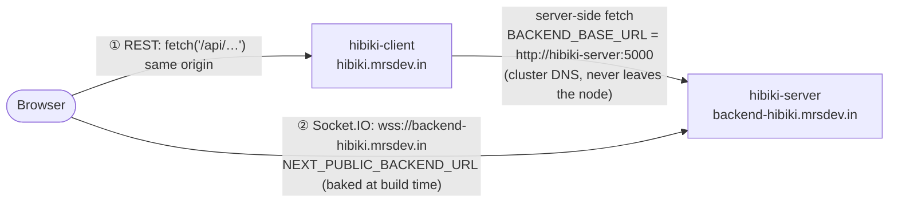
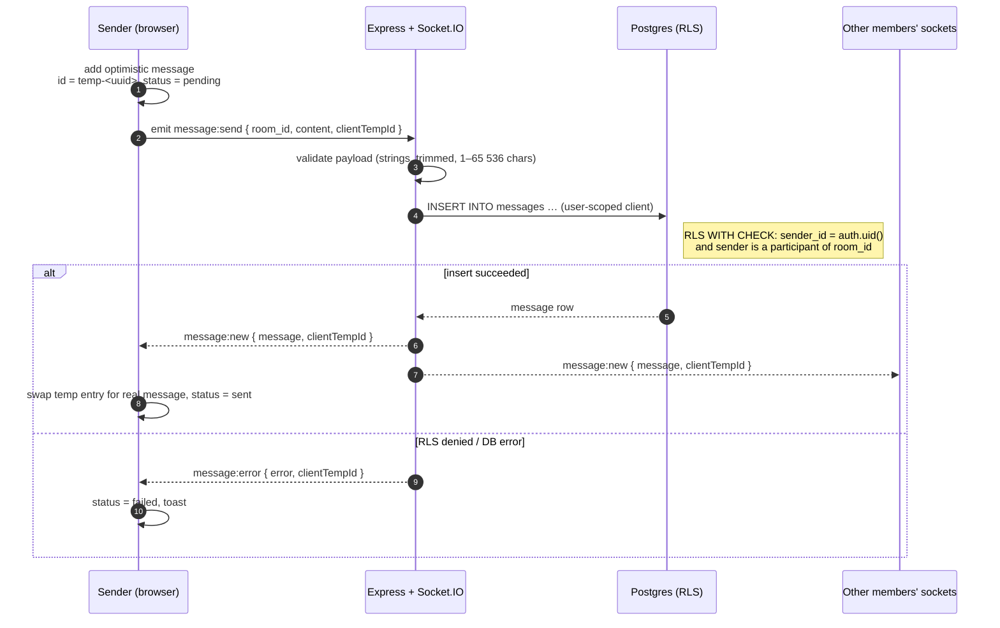
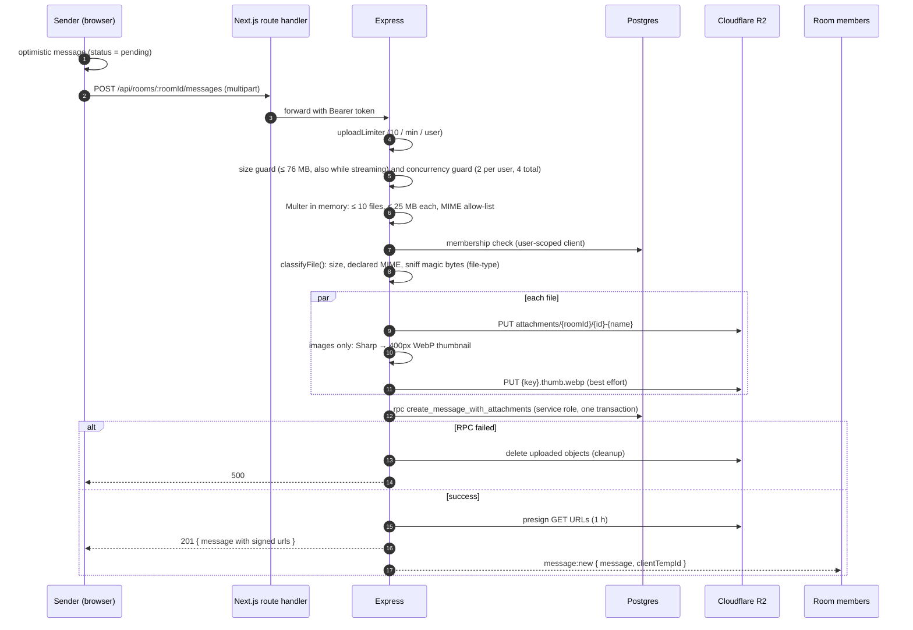
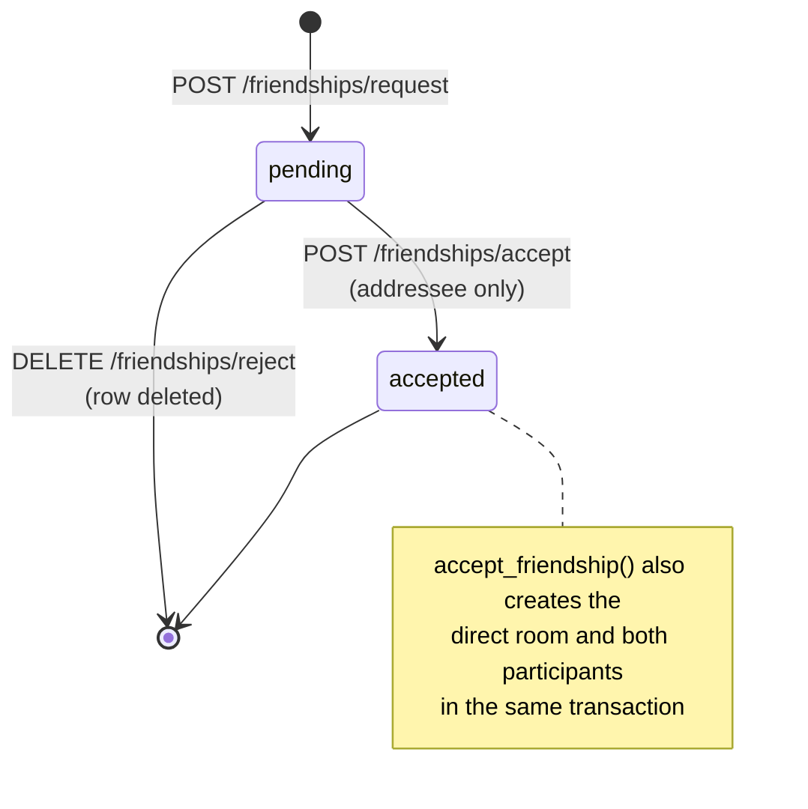
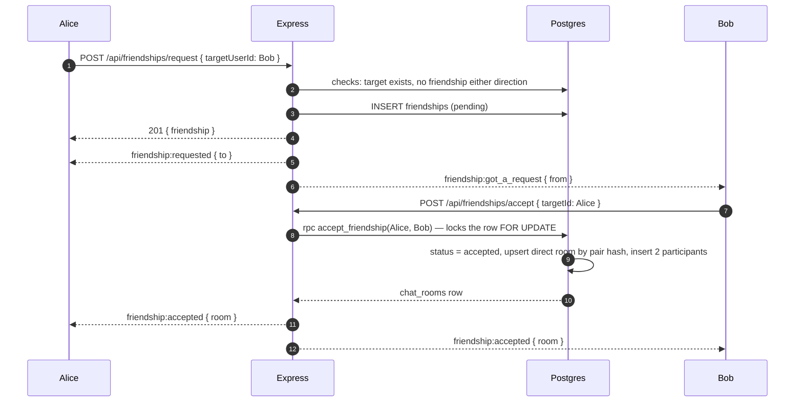
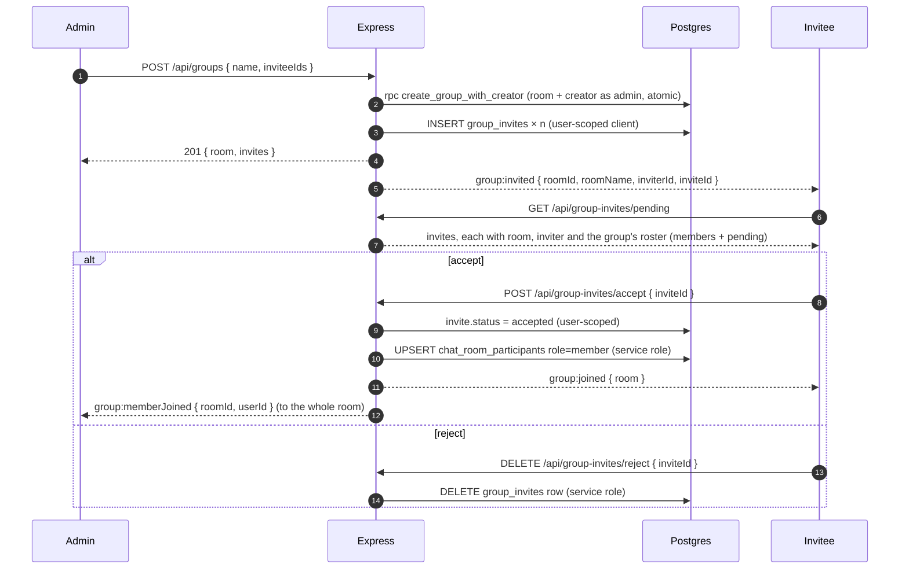
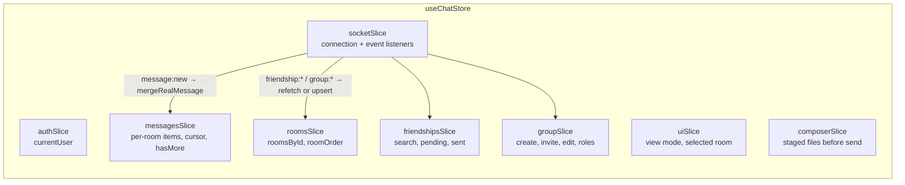
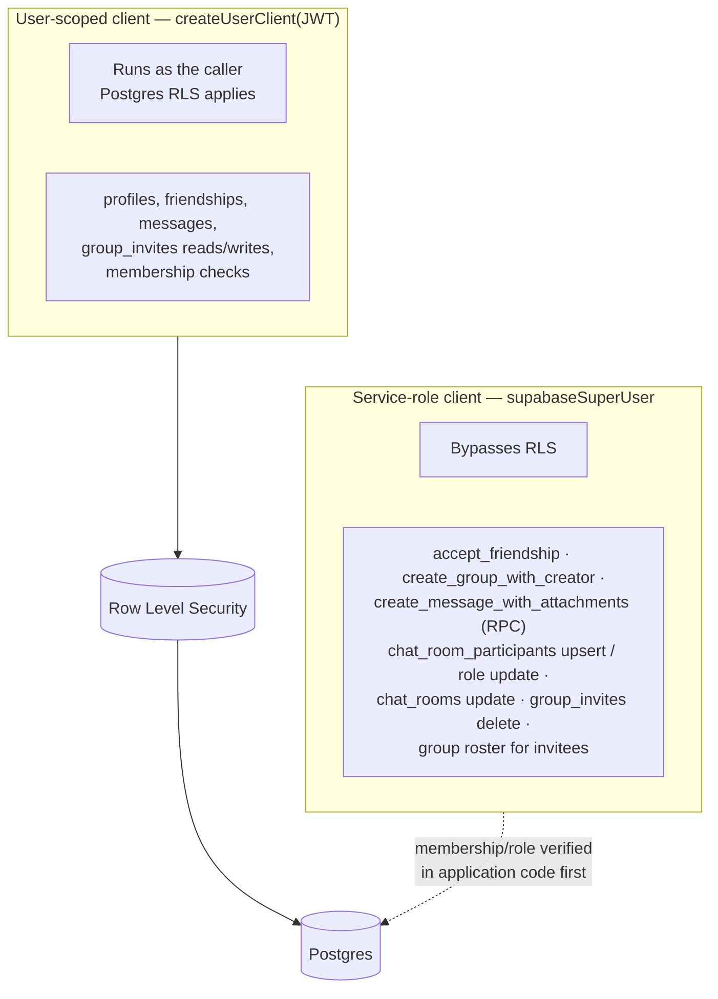

# Architecture

How Hibiki is put together and why. For exact request and response shapes see [API.md](API.md), for the schema see [DATABASE.md](DATABASE.md), and for how it is deployed see [DEPLOYMENT.md](DEPLOYMENT.md).

## Contents

1. [System overview](#system-overview)
2. [Authentication](#authentication)
3. [Two network paths from the browser](#two-network-paths-from-the-browser)
4. [Sending a text message](#sending-a-text-message)
5. [Sending attachments](#sending-attachments)
6. [Friend requests](#friend-requests)
7. [Groups and invites](#groups-and-invites)
8. [Socket.IO rooms](#socketio-rooms)
9. [Client state](#client-state)
10. [Security model](#security-model)
11. [External services](#external-services)
12. [Known limitations](#known-limitations)

---

## System overview

| Component | Responsibility |
|---|---|
| **Next.js route handlers** (`client/app/api/*`) | Thin proxies. They read the Supabase session from the cookie, extract the access token, and forward to Express. The token never sits in browser JavaScript for REST calls. |
| **Express routers** (`server/routes/*`) | HTTP layer: validation, status codes, and Socket.IO emits after a successful write. |
| **Services** (`server/services/*`) | Business logic for groups, profiles and attachments. Routes stay thin. |
| **Socket.IO** (`server/socket/*`) | Authenticates the handshake, places the socket in rooms, handles `message:send` and the room-join events. |
| **Supabase** | Identity (GoTrue), the data API (PostgREST), and the database with RLS. |

## Authentication

Hibiki uses Supabase email and password auth with email verification. The Supabase session lives in cookies managed by `@supabase/ssr`.

Two details worth knowing:

- **Profiles are created by a database trigger**, not by application code. `handle_new_user()` copies `username` and `full_name` from the sign-up metadata into `public.profiles`. This is why registration needs no second API call.
- **The backend verifies every token by asking Supabase** (`auth.getUser(token)`) instead of verifying the JWT signature locally. This costs one network hop per request, but it means revoked sessions stop working immediately.

## Two network paths from the browser

| Path | Used for | Why |
|---|---|---|
| ① Browser → Next.js → Express | All REST calls, including multipart uploads | Keeps the bearer token handling server-side and avoids CORS for REST. |
| ② Browser → Express directly | Socket.IO only | A WebSocket cannot be proxied through a Next.js route handler. The handshake carries the Supabase access token in `auth.token`. CORS on the socket is limited to `ALLOWED_ORIGIN`. |

**Client IP.** Traefik records the browser's real address in `X-Forwarded-For`. The Next.js route handlers copy that header onto their calls to Express (`client/lib/backend.ts`), and Express trusts it only when the TCP peer is a private-network address (`trust proxy` in `server/app.ts`). Without this every REST call would appear to come from the Next.js pod, and all users would share one rate-limit bucket. A request from a public address cannot choose its own IP, and extra entries a client prepends are ignored.

Because `NEXT_PUBLIC_BACKEND_URL` is inlined into the JavaScript bundle by `next build`, it is passed as a Docker build argument in CI (see [DEPLOYMENT.md](DEPLOYMENT.md#cicd-pipeline)). `BACKEND_BASE_URL` is read at runtime on the server and is set in `k8s/client.yaml`.

## Sending a text message

Text goes over the socket. The client shows the message immediately and reconciles it when the server echoes it back.

`io.to(room_id).emit(...)` also reaches the sender, so the sender and recipients take the same path through `mergeRealMessage`. The only difference is that the sender's `clientTempId` matches a pending entry and replaces it.

## Sending attachments

Files go over REST (multipart), not the socket, because of their size. The server then broadcasts the finished message over the socket, so recipients see it exactly like a text message.

Security properties of this path:

- **Content is verified, not just labelled.** The declared MIME type must be on the allow-list *and* the real file signature must map to the same attachment type. Plain text and CSV have no magic bytes and are accepted on the declared type only.
- **A failed upload leaves no orphans.** If any R2 upload or the database RPC fails, already-uploaded objects are deleted.
- **Messages and attachments are created atomically** by the `create_message_with_attachments` function. It re-checks room membership itself as defence in depth.
- **No public files.** Objects are private. Every read generates a fresh presigned URL that expires after one hour, so URLs are never stored in the database. Non-previewable files are served with `Content-Disposition: attachment`.

## Friend requests

Two properties come from `accept_friendship`:

- **Race-safe.** The pending row is locked, so two concurrent accepts, or an accept racing a reject, cannot both succeed.
- **One room per pair.** `direct_pair_hash` is the two user IDs sorted and joined with `_`, and it carries a `UNIQUE` constraint. Accepting twice returns the same room.

## Groups and invites

There is no way to add someone to a group directly. Everyone, including people named at creation time, goes through an invite that the invitee must accept.

- **Rejecting deletes** the invite row instead of marking it rejected. `UNIQUE (room_id, invitee_id)` would otherwise stop an admin from ever re-inviting that person.
- **Roles:** `admin` or `member`. Only admins can invite, edit the group, or change roles. The route checks the caller's role explicitly and returns a clear `403`, and the database enforces it again for the one case that has an RLS policy.
- **Live edits:** `PATCH /groups/:roomId` and the role endpoint both broadcast `room:updated` to the whole group. Each receiving client re-derives its own `currentUserId` and `currentUserRole` from the member list, because the payload is built from the acting admin's point of view.

## Socket.IO rooms

Every connected socket joins two kinds of Socket.IO rooms. This is what makes targeted delivery possible:

| Room name | Who joins | Used for |
|---|---|---|
| `<userId>` | Automatically, on connect | Personal notifications: `friendship:*`, `group:invited`, `group:joined`. Reaches all of that user's open tabs and devices. |
| `<roomId>` | After `room:join` or `rooms:joinMany`, which verify membership against `chat_room_participants` | Chat traffic: `message:new`, `group:memberJoined`, `room:updated`. |

On app boot, the client loads rooms, pending requests and invites, and the most recent page of messages for every room. Only then does it connect the socket and send one `rooms:joinMany` with every room ID. The server silently drops any ID the user is not a member of. When a user joins a group live, the client emits `room:join` for that new room.

## Client state

All client state lives in one Zustand store (`client/store/chatStore.ts`), built from slices wrapped in Immer. Components read through selectors and call actions. They never touch the socket directly.

The messages slice keeps, per room, a `Map` of items keyed by message ID, or by `clientTempId` while a message is pending. It also keeps a `cursor` (the `created_at` of the oldest loaded message) and `hasMore`. Scrolling to the top calls `GET /api/messages?roomId=…&before=<cursor>`. The server returns newest-first, and the slice reverses each page for display.

## Security model

**Principle: least privilege where the database allows it, explicit checks where it does not.**

- **API roles hold only the privileges the backend needs.** `anon` can read `profiles` only. `authenticated` can read the tables its RLS policies expose and perform just the writes the backend makes with a user token (messages, friend requests, invites, own profile). `chat_rooms`, `chat_room_participants` and `message_attachments` are read-only for users: creating a room, adding a participant, or attaching a file is done by the backend through the service role or a `SECURITY DEFINER` function.
- **Privileged functions are callable only by `service_role`.** `accept_friendship`, `create_group_with_creator` and `create_message_with_attachments` take user ids as parameters, so they must never be reachable through the public API. Each backend path authenticates the caller and verifies membership or admin role *before* using them.
- `group_invites` has no `DELETE` privilege for users, which is why rejecting an invite goes through the service role (with a lookup scoped to the invitee's own pending invite). An invitee may change only the `status` of their own pending invite, and only an admin of a room can create an invite for it.
- The service-role key exists **only** in the backend's Kubernetes secret and is never sent to the browser. The browser only ever sees the publishable (anon) key, which is public by design. Everything that matters is therefore enforced by database privileges and RLS, not by hiding the API.
- Input hardening: Zod on socket payloads; length caps on messages (65 536 chars), names (255), status (150), and username regex `^[_a-zA-Z][a-zA-Z0-9._]{2,19}$`, repeated as database CHECK constraints so they hold even for writes that bypass the backend; password policy (8+ chars with a letter and a digit) at registration.
- Rate limits and upload guards protect expensive and abusable routes: see [API.md → Rate limits](API.md#rate-limits).

The full review, its findings and the automated checks are in [SECURITY.md](SECURITY.md).

Full policy list: [DATABASE.md → Row Level Security](DATABASE.md#row-level-security).

## External services

| Service | Role | Access pattern |
|---|---|---|
| **Cloudflare R2** | Message attachments, with thumbnails stored next to the original as `{key}.thumb.webp` | S3-compatible API via AWS SDK v3. Object key: `attachments/{roomId}/{attachmentId}-{sanitizedName}`. Presigned GET URLs valid for 1 hour. |
| **Cloudinary** | User and group avatars | Uploaded as `authenticated` type at a fixed `public_id` (`avatars/{userId}`, `groups/{roomId}`) with `overwrite`, so a re-upload replaces the old image. Delivered through signed 512×512 URLs. The DB stores `avatar_public_id` and `avatar_version`, never a URL, and the signed URL is derived on every read. |
| **Supabase** (self-hosted) | Auth, Postgres, REST | `supabase.mrsdev.in` through Kong. Realtime is **not** used by the app. Socket.IO handles all real-time delivery, even though some tables are in the `supabase_realtime` publication. |

## Known limitations

These are facts about the current implementation, listed so nobody has to rediscover them. Security-related items are also in [SECURITY.md](SECURITY.md#residual-risks-and-design-trade-offs).

1. **One backend replica only.** Socket.IO state (rooms, connected sockets) is in process memory and there is no Redis adapter. With more than one replica, an `emit` from replica A would not reach sockets connected to replica B. The Deployment is pinned to `replicas: 1`. The adapter is the only thing blocking horizontal scaling.
2. **Rate limiter and upload-guard state is in memory** (same reason). Limits are per process and reset on restart.
3. **Some writes bypass the backend.** Text messages, friend requests and group invites are inserted into the database by a user-scoped client. Security depends on RLS and constraints, not on the backend, so those three writes are not covered by the backend's rate limiters (the socket path has its own throttle).
4. **No delivery or read receipts.** The `received` status exists in the types and the double-check icon, but the client sets it only on other people's messages, so your own messages end at *sent*.
5. **Socket tokens are not refreshed.** The socket authenticates once with the access token it had at page load (valid one hour) and the backend reuses that token for database calls made on that socket. Reconnecting also reuses it. By code inspection, a tab left open past the token's expiry can no longer send until it is reloaded. Not yet reproduced against production.
6. **`rooms:joinMany` sends no acknowledgement.** Clients learn about a bad room ID only by never receiving events for it.
7. **Group creation edge case.** If the group is created but inserting the invites fails, the API returns HTTP `207` with `success: false`. The group already exists and has its creator in it.
8. **Argo CD and manual changes.** The application has `selfHeal: true`, so `kubectl edit` changes to anything under `k8s/` are reverted. Change the manifests in git instead.
9. **Email confirmation depends on SMTP** being configured on the Supabase Auth service. See [DEPLOYMENT.md](DEPLOYMENT.md#supabase-coolify).
