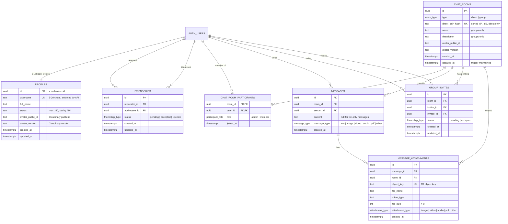
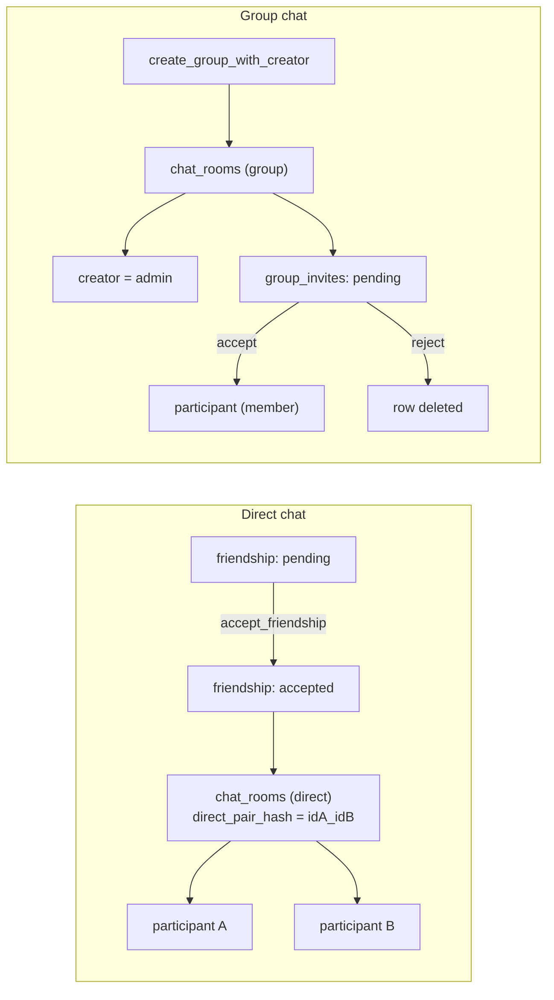

# Database

Hibiki's data lives in the `public` schema of a self-hosted Supabase Postgres 15 instance. The schema is defined by forward-only SQL migrations in [`supabase/migrations/`](../supabase/migrations). There is no ORM. The backend talks to Postgres through PostgREST (`supabase-js`).

`auth.users` (owned by GoTrue) is the identity table. Everything in `public` points back at it.

## Contents

- [Entity-relationship diagram](#entity-relationship-diagram)
- [Tables](#tables)
- [Enums](#enums)
- [Functions and triggers](#functions-and-triggers)
- [Row Level Security](#row-level-security)
- [Indexes](#indexes)
- [Realtime publication](#realtime-publication)
- [How rooms, friendships and invites relate](#how-rooms-friendships-and-invites-relate)

---

## Entity-relationship diagram

All foreign keys point at their parent with `ON DELETE CASCADE`. Deleting a user removes their profile, friendships, participations, messages and invites. Deleting a room removes its participants, messages, attachments and invites.

## Tables

| Table | Purpose | Notable constraints |
|---|---|---|
| `profiles` | Public identity: username, display name, status, avatar reference | `username` is `UNIQUE` and must match `^[_a-zA-Z][a-zA-Z0-9._]{2,19}$`. `full_name` ≤ 255 and `status` ≤ 150 characters. `avatar_public_id` may only be `avatars/<own id>`. `id` references `auth.users`. |
| `friendships` | A friend request and its outcome | `UNIQUE (requester_id, addressee_id)`. `CHECK (requester_id <> addressee_id)`. |
| `chat_rooms` | A conversation, either `direct` (1:1) or `group` | A direct room must have `name IS NULL`, and a group must have a non-blank name. `description` is allowed only on groups. `direct_pair_hash` is `UNIQUE`. `avatar_public_id` may only be `groups/<own id>`. |
| `chat_room_participants` | Membership and role | Composite PK `(room_id, user_id)` |
| `group_invites` | A pending invitation to a group | `UNIQUE (room_id, invitee_id)` |
| `messages` | One chat message | A `text` message must have non-blank `content` |
| `message_attachments` | Files belonging to a message | `UNIQUE (object_key)`. `file_size > 0`. |

**Avatars are stored as references, not URLs.** `avatar_public_id` and `avatar_version` identify an asset in Cloudinary. The backend derives a signed delivery URL from them on every read, so no URL is ever persisted or cached.

**Attachments store only the R2 object key.** Download URLs are presigned on read (1 hour). The thumbnail's key is derived from the original (`{object_key}.thumb.webp`), so it needs no column.

## Enums

| Type | Values |
|---|---|
| `room_type` | `direct`, `group` |
| `participant_role` | `admin`, `member` |
| `friendship_type` | `pending`, `accepted`, `rejected` (also reused by `group_invites.status`) |
| `message_type` | `text`, `image`, `video`, `audio`, `pdf`, `other` |
| `attachment_type` | `image`, `video`, `audio`, `pdf`, `other` |

The application deletes rejected friend requests and group invites instead of storing `rejected`, so that value is never written today.

## Functions and triggers

| Name | Kind | Who can execute | What it does |
|---|---|---|---|
| `accept_friendship(requester, accepter)` | `SECURITY DEFINER` RPC. Returns the `chat_rooms` row. | **`service_role` only** | In one transaction: locks the pending friendship (`FOR UPDATE`), sets it to `accepted`, upserts the direct room by `direct_pair_hash`, and inserts both participants. Raises `P0002` if no pending request exists, which the API maps to `404`. |
| `create_group_with_creator(creator, name)` | `SECURITY DEFINER` RPC. Returns the `chat_rooms` row. | **`service_role` only** | Inserts the group room and the creator as `admin` atomically, so there is never a room with no members. |
| `create_message_with_attachments(sender, room, content, message_type, attachments jsonb)` | `SECURITY DEFINER` RPC. Returns `{ message, attachments }`. | **`service_role` only** | Verifies the sender is a participant (`P0005`), validates text and attachment rules (`P0003`, `P0004`), then inserts the message and all its attachment rows in one transaction. |
| `handle_new_user()` | `SECURITY DEFINER` trigger function. Fired by `on_auth_user_created` (`AFTER INSERT ON auth.users`). | nobody directly (trigger machinery) | Inserts the matching `profiles` row using `username` and `full_name` from the sign-up metadata. If the metadata violates the profile constraints the sign-up fails. |
| `is_room_participant(room, user)` | `SECURITY DEFINER` SQL function | `authenticated`, `service_role` | Used by RLS policies. It avoids infinite recursion when a policy on `chat_room_participants` needs to read `chat_room_participants`. |
| `set_updated_at()` | trigger function | nobody directly | Maintains `chat_rooms.updated_at` through `trg_chat_rooms_updated_at`. |

**Why the RPCs are `service_role`-only.** They take user ids as plain parameters and run as the table owner (which bypasses RLS). If a signed-in user, or just someone holding the public key, could call them through the API, they could act as any other user. They are therefore callable only by the backend, which authenticates the real caller first and passes that verified id. All `SECURITY DEFINER` functions pin `search_path = public, pg_temp`.

**Adding a function?** PostgreSQL grants `EXECUTE` to everyone by default. Follow `CREATE FUNCTION` with `REVOKE ALL ON FUNCTION … FROM PUBLIC;` and a targeted `GRANT`, then run `supabase/scripts/audit-grants.sql`, which lists anything the API roles can execute.

## Row Level Security

RLS is enabled on every table. The backend queries with the **caller's JWT** wherever possible, so these policies are the first line of defence. A missing policy for an operation means that operation is denied to normal users. On top of RLS, the API roles hold only the table privileges listed in the last column, so an operation that has no grant is rejected before RLS is even consulted.

| Table | `SELECT` | `INSERT` | `UPDATE` | `DELETE` | Privileges held by `authenticated` |
|---|---|---|---|---|---|
| `profiles` | everyone, including `anon` (`true`, for the registration username check) | none (created by trigger) | own row only | none | `SELECT`, `UPDATE` |
| `friendships` | either party | `requester_id = auth.uid()` and `status = 'pending'` | none (accepting goes through `accept_friendship`) | addressee, only while `pending` | `SELECT`, `INSERT`, `DELETE` |
| `chat_rooms` | participants | none | none for users (the policy for group admins exists but no `UPDATE` privilege is granted; the backend edits groups with the service role) | none | `SELECT` |
| `chat_room_participants` | participants of the same room (via `is_room_participant`) | none | none | none | `SELECT` |
| `group_invites` | inviter or invitee | inviter is `auth.uid()`, is an **admin of the room**, is not the invitee, and `status = 'pending'` | invitee only, only while `pending`, only the `status` column, only to `accepted`/`rejected` | none (service role) | `SELECT`, `INSERT`, `UPDATE (status)` |
| `messages` | participants of the room | sender is `auth.uid()`, participant of the room, `message_type = 'text'`, content ≤ 65 536 characters | none | none | `SELECT`, `INSERT` |
| `message_attachments` | participants of the room (via `is_room_participant`) | none | none | none | `SELECT` |

The `anon` role holds `SELECT` on `profiles` and nothing else. `TRUNCATE`, `REFERENCES` and `TRIGGER` are not granted to either API role.

What follows from the table:

- **Rooms, participants and attachments cannot be created by a normal user directly.** The backend does it through the service role and the RPCs above, after its own checks.
- **Joining a group requires an invite created by an admin.** Nobody can insert an invite for themselves, and an invitee cannot redirect their invite to another room.
- **Group invites cannot be deleted by users.** Rejecting an invite is done by the backend with the service role, scoped to the invitee's own pending invite.
- **Messages are immutable** for normal users: no edit and no delete.
- **Any holder of the public key can look up profiles.** The `username lookup` policy exposes `profiles` rows so that registration and search work. Only `id`, `username`, `full_name`, `status` and the avatar reference are stored there. Email addresses stay in `auth.users`.
- **Direct inserts bypass the backend.** A signed-in user can still insert a text message, a friend request or an invite straight through the Supabase API, so these writes are bounded by RLS and constraints but not by the backend's rate limiters. See [SECURITY.md](SECURITY.md#residual-risks-and-design-trade-offs).

## Indexes

| Index | On | Serves |
|---|---|---|
| `idx_messages_room_created_at` | `messages (room_id, created_at DESC)` | Cursor pagination (`WHERE room_id = ? AND created_at < ? ORDER BY created_at DESC LIMIT n`) |
| `idx_messages_room_type` | `messages (room_id, message_type) WHERE message_type <> 'text'` | Partial index for media-only lookups |
| `idx_participants_user` | `chat_room_participants (user_id)` | "Which rooms is this user in?" |
| `idx_friendships_requester_status`, `idx_friendships_addressee_status` | `(requester_id, status)`, `(addressee_id, status)` | Pending-request lookups |
| `idx_group_invites_invitee_status` | `group_invites (invitee_id, status)` | Pending-invite lookup |
| `idx_attachments_message`, `idx_attachments_room` | `message_attachments (message_id)`, `(room_id)` | Attachment fetch per message and per room |
| `profiles_username_trgm_idx` | `GIN (username gin_trgm_ops)` on `profiles` | Fast `ILIKE '%q%'` substring search (needs the `pg_trgm` extension) |

## Realtime publication

`supabase_realtime` includes `profiles`, `friendships`, `chat_rooms` and `messages`. The application does **not** subscribe to Supabase Realtime. All live updates are delivered by Socket.IO (see [API.md → Socket.IO](API.md#socketio)). The publication membership was carried over from the original Supabase project.

## How rooms, friendships and invites relate

## Applying changes

Schema changes are new files in `supabase/migrations/`. The production database is not exposed to the internet, so they are applied over SSH by `supabase/scripts/deploy-migration.sh`, atomically (the migration and its bookkeeping row commit together). See [supabase/README.md](../supabase/README.md).

Migrations recorded on the production database:

| Version | Purpose |
|---|---|
| `20260706120000_initial_schema` | Baseline captured when moving from Supabase Cloud to the self-hosted instance |
| `20261015120000_restrict_function_privileges` | RPCs executable by `service_role` only; pinned `search_path`; trigger/helper lockdown |
| `20261015120100_least_privilege_tables_and_rls` | Least-privilege table grants, tightened policies, CHECK constraints |

Each hardening migration has a manual recovery script in `supabase/rollbacks/`. After any migration, run `supabase/scripts/run-authz-tests.sh` (rolled back, safe on production) and `supabase/scripts/audit-grants.sql`.
