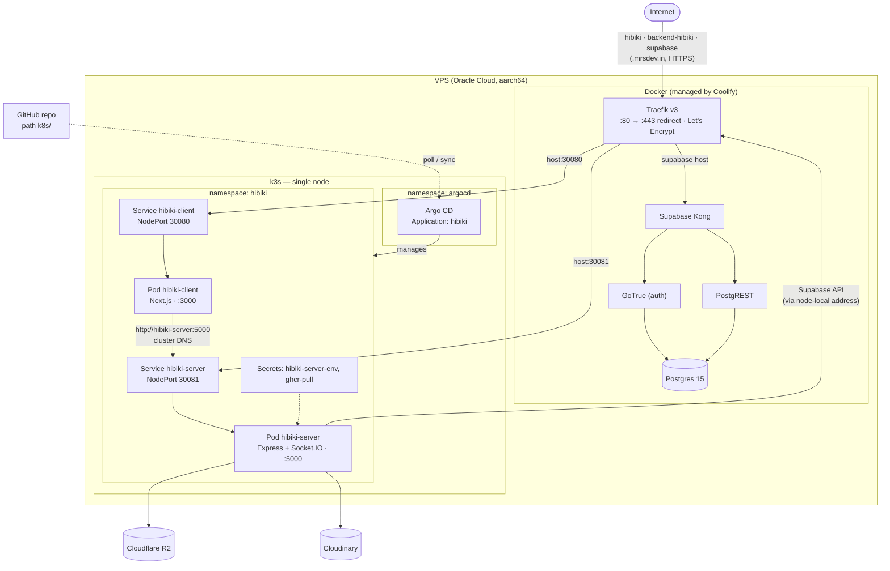
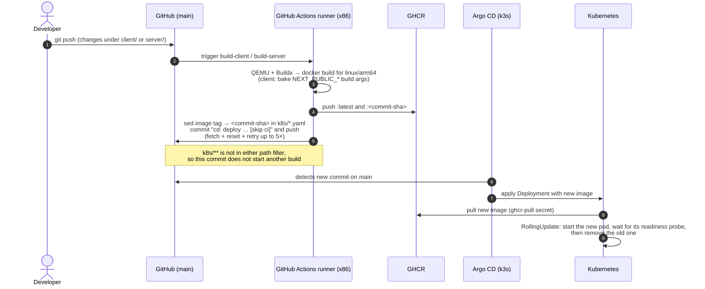

# Deployment

Everything runs on **one Oracle Cloud ARM64 VPS** (Ubuntu 24.04, 2 vCPU, about 11 GB RAM). Two layers share the machine:

- **k3s** (single-node Kubernetes) runs the Hibiki frontend and backend, deployed by **Argo CD**.
- **Coolify** (Docker) runs the reverse proxy (**Traefik**) and the self-hosted **Supabase** stack, alongside other unrelated services.

Host-specific details (hostnames of the box, container names, file paths, credentials) are intentionally **not** in this repository. This document describes the design and the procedures. A maintainer keeps the machine-specific notes privately.

## Contents

- [Production topology](#production-topology)
- [Request routing and TLS](#request-routing-and-tls)
- [Kubernetes resources](#kubernetes-resources)
- [CI/CD pipeline](#cicd-pipeline)
- [Configuration reference](#configuration-reference)
- [Supabase (Coolify)](#supabase-coolify)
- [Operations runbook](#operations-runbook)
- [History](#history)
- [Hardening status and backlog](#hardening-status-and-backlog)

---

## Production topology



| Public hostname | Routed by Traefik to | Serves |
|---|---|---|
| `hibiki.mrsdev.in` | k3s NodePort 30080, Service `hibiki-client` | Next.js app |
| `backend-hibiki.mrsdev.in` | k3s NodePort 30081, Service `hibiki-server` | Express API and Socket.IO |
| `supabase.mrsdev.in` | Supabase Kong container | Supabase API gateway (auth, REST) |

**Network exposure.** Public traffic is meant to enter only through Traefik (80/443) plus key-only SSH. The k3s API, kubelet, the NodePorts and Postgres are not reachable from the internet; the NodePorts are used only by Traefik on the same host.

## Request routing and TLS

Traefik is the Coolify-managed proxy container. Its Docker network can reach the k3s NodePorts on the host. Routing for Hibiki is a **file-provider** config in Coolify's proxy directory on the VPS (it is not stored in this repository). For each of the two Hibiki hostnames it defines:

- an `http` router that redirects to HTTPS, and
- an `https` router with `tls.certresolver: letsencrypt` (certificates are issued and renewed automatically), pointing at a `loadBalancer` service whose single server is the NodePort.

Supabase's routing comes from Docker labels that Coolify writes on the Kong container.

**Client IP handling.** Traefik is the only public entry point and sets `X-Forwarded-For` from the real TCP peer, overwriting anything a client sends (no trusted forwarded-header sources are configured). The Next.js route handlers copy that header onto their calls to the backend (`client/lib/backend.ts`), and the backend trusts it only from private-network peers (`app.set('trust proxy', 'loopback, linklocal, uniquelocal')` in `server/app.ts`). Rate limiting therefore sees the real client address, and a request from a public address cannot choose its own.

**In-cluster hairpin.** The backend Deployment sets `hostAliases` so the Supabase hostname resolves to the node's private address inside the pod. Calls from the backend to Supabase go straight to Traefik on the same machine instead of leaving through the public IP and coming back.

**Service-to-service.** The client pod reaches the backend through ordinary cluster DNS (`http://hibiki-server:5000`, set as `BACKEND_BASE_URL` in `k8s/client.yaml`). This traffic never touches Traefik.

## Kubernetes resources

Manifests live in [`k8s/`](../k8s) and are the only thing Argo CD syncs.

| File | Resources | Key settings |
|---|---|---|
| `k8s/client.yaml` | Deployment `hibiki-client`, Service `hibiki-client` | 1 replica. Port 3000. Env `HOSTNAME=0.0.0.0` (Kubernetes sets `HOSTNAME` to the pod name, which would make Next.js bind to the wrong interface) and `BACKEND_BASE_URL=http://hibiki-server:5000`. NodePort **30080**. |
| `k8s/server-deployment.yaml` | Deployment `hibiki-server` | 1 replica (see [limitations](ARCHITECTURE.md#known-limitations)). Port 5000. `envFrom` secret `hibiki-server-env`. `hostAliases` for the Supabase hostname. |
| `k8s/server-service.yaml` | Service `hibiki-server` | NodePort **30081** → 5000. |

Both Deployments share this hardening profile:

| Setting | Value | Why |
|---|---|---|
| `securityContext` (pod) | `runAsNonRoot`, uid/gid 1000, `seccompProfile: RuntimeDefault` | Never root; default syscall filter |
| `securityContext` (container) | `allowPrivilegeEscalation: false`, `readOnlyRootFilesystem: true`, `capabilities.drop: [ALL]` | A compromised process can't write to the image or gain privileges |
| Writable paths | `emptyDir` on `/tmp` (and `.next/cache` for the client) | The only scratch space |
| `automountServiceAccountToken` | `false` | The apps never call the Kubernetes API |
| Readiness probe | server `GET /`, client `GET /login` | A rolling update only proceeds once the new pod answers; the old pod keeps serving until then |
| Liveness probe | server `GET /`, client TCP | Restart only if truly wedged. Generous timeouts because the node is shared. |
| Memory | requests 128 Mi / 96 Mi, limits **1 Gi** / **512 Mi** | Measured use is about 50 Mi each. The server limit leaves room for the capped concurrent uploads. A runaway can't take the whole VPS. |
| CPU | request 50m, **no limit** | CFS throttling hurts latency on a shared node |

Both Deployments use `imagePullSecrets: ghcr-pull` because the GHCR images are private. Image references are rewritten by CI to an immutable commit SHA (for example `ghcr.io/mars9563/hibiki-server:<sha>`). A local clone may still show `:latest` until you `git pull` the CI commits. **Never commit `:latest` over a CI-written SHA**: Argo CD would then deploy whatever `latest` is.

**Objects that exist in the cluster but not in git** (created by hand, referenced by the manifests):

| Secret (namespace `hibiki`) | Contents |
|---|---|
| `hibiki-server-env` | The backend's environment variables (key names listed below), injected whole with `envFrom` |
| `ghcr-pull` | Docker registry credentials for pulling from `ghcr.io` |

Argo CD is installed in namespace `argocd`. Its `Application` is named `hibiki`:

| Setting | Value |
|---|---|
| Source | `https://github.com/Mars9563/hibiki.git`, branch `main`, path `k8s` |
| Destination | `https://kubernetes.default.svc`, namespace `hibiki` |
| Sync policy | **Automated**, `prune: true`, `selfHeal: true` |

Because `selfHeal` is on, anything changed in the cluster by hand under `k8s/` is reverted to match git. Secrets are outside `k8s/`, so Argo does not touch them.

## CI/CD pipeline

Two workflows, [`build-client.yml`](../.github/workflows/build-client.yml) and [`build-server.yml`](../.github/workflows/build-server.yml), run on pushes to `main`. Each is limited by a path filter to its own folder (`client/**` or `server/**`) plus its own workflow file.



**Why `arm64` with QEMU:** the VPS is aarch64 and the GitHub runner is x86. Building under emulation avoids needing a self-hosted runner. Native dependencies (notably `sharp`) are installed inside the target-architecture build stage, so the correct binary is fetched.

**Race handling.** The client and server workflows can finish at nearly the same time and both push to `main`, but each edits a different manifest file. Each attempt does `git fetch` and `git reset --hard origin/main`, redoes its one-line edit, and tries to push, so a lost race simply retries instead of conflicting.

**Client build arguments.** `NEXT_PUBLIC_*` variables are inlined into the browser bundle at `next build`, so the production values are passed as Docker build args in the workflow. This is why one image corresponds to exactly one environment.

| Build arg | Production value |
|---|---|
| `NEXT_PUBLIC_SUPABASE_URL` | `https://supabase.mrsdev.in` |
| `NEXT_PUBLIC_SUPABASE_PUBLISHABLE_KEY` | the Supabase *publishable* (anon) key. It is public by design (it is shipped to every browser) and is not a secret. |
| `NEXT_PUBLIC_BACKEND_URL` | `https://backend-hibiki.mrsdev.in` (Socket.IO target) |

**Images.**

| | Client | Server |
|---|---|---|
| Base | `node:22-alpine`, two stages | `node:22-alpine`, two stages |
| Build | `npm ci` then `next build` (`output: standalone`) | `npm ci` then `tsc --outDir dist` |
| Runtime contents | Standalone server, `.next/static`, `public/` | Production-only `node_modules` and compiled `dist/` |
| Command | `node server.js` | `node dist/index.js` |
| User | `node` (non-root) | `node` (non-root) |
| Registry | `ghcr.io/mars9563/hibiki-client` | `ghcr.io/mars9563/hibiki-server` |

**Tests:** the pipeline builds and deploys. It does not run a test suite or a linter. The regression tests in the repo (see [SECURITY.md](SECURITY.md#automated-checks)) are run by hand.

## Configuration reference

### Backend (`server/`): Kubernetes secret `hibiki-server-env`, or `server/.env` locally

| Variable | Required | Purpose |
|---|---|---|
| `SUPABASE_URL` | yes | Supabase API base URL (`https://supabase.mrsdev.in` in production) |
| `SUPABASE_PUBLISHABLE_KEY` | yes | Public key. Used for token verification and for user-scoped clients that run under RLS. |
| `SUPABASE_SERVICE_ROLE_KEY` | yes | **Secret.** Bypasses RLS. Used only for the privileged operations described in [Architecture](ARCHITECTURE.md#security-model). Never sent to the browser. |
| `ALLOWED_ORIGIN` | yes | The frontend's origin for CORS on REST and Socket.IO (`https://hibiki.mrsdev.in`). `http://localhost:3000` is also always allowed on REST. |
| `CLOUDINARY_CLOUD_NAME`, `CLOUDINARY_API_KEY`, `CLOUDINARY_API_SECRET` | yes | Avatar upload and URL signing |
| `R2_ACCOUNT_ID`, `R2_ACCESS_KEY_ID`, `R2_SECRET_ACCESS_KEY`, `R2_BUCKET_NAME` | yes | Cloudflare R2 attachment storage |
| `PORT` | no | Defaults to `5000` (not set in production) |

`CLOUDINARY_UPLOAD_PRESET` may appear in older `.env` files and secrets. The code does not read it.

### Frontend (`client/`)

| Variable | When read | Purpose |
|---|---|---|
| `NEXT_PUBLIC_SUPABASE_URL` | **build time** (inlined) | Supabase URL for browser and server clients |
| `NEXT_PUBLIC_SUPABASE_PUBLISHABLE_KEY` | **build time** (inlined) | Supabase publishable key |
| `NEXT_PUBLIC_BACKEND_URL` | **build time** (inlined) | Where the browser opens its Socket.IO connection. Defaults to `http://localhost:5000` if unset. |
| `BACKEND_BASE_URL` | **runtime**, server side only | Where Next.js route handlers and server components send REST calls (`http://hibiki-server:5000` in the cluster) |

## Supabase (Coolify)

Supabase is a Coolify "service" (a Docker Compose stack Coolify manages). The VPS also runs other Supabase stacks and unrelated services for other projects. They are not part of Hibiki.

| Component | Role for Hibiki |
|---|---|
| Kong | Public gateway at `supabase.mrsdev.in` |
| GoTrue (auth) | Email and password auth, JWT issuing (access tokens last 1 hour) |
| PostgREST | The data API the backend queries. Exposes the `public` schema. |
| Postgres 15 | The database. **Not exposed to the internet**; reachable only from the host itself. |
| Studio, Meta, Supavisor, Realtime, Storage, Edge Functions, Analytics, MinIO, imgproxy, Vector | Part of the stack. Hibiki does not use Supabase Realtime or Storage. |

**Email delivery.** The app requires email confirmation (`GOTRUE_MAILER_AUTOCONFIRM=false`). That only works if the auth service has an SMTP server configured (`GOTRUE_SMTP_*`). Without it GoTrue uses a no-op mail client: sign-ups are created but the confirmation email is never sent, so the account cannot sign in until it is confirmed by an admin. Configure SMTP (or temporarily enable auto-confirm) for self-service registration to work.

Stack-level secrets (Postgres superuser password, JWT secret) live in Coolify's environment file for the resource on the VPS. They are needed only for infrastructure changes such as rotating keys.

## Operations runbook

Run on the VPS over SSH. `kubectl` is bundled with k3s (`sudo k3s kubectl`).

### Status

```bash
sudo k3s kubectl -n hibiki get pods,svc            # both pods Running, 1/1
sudo k3s kubectl -n argocd get applications        # hibiki: Synced / Healthy
sudo k3s kubectl -n hibiki get deploy -o wide      # which image tag is live
curl -s https://backend-hibiki.mrsdev.in/          # → Hibiki backend is alive
```

### Logs

```bash
sudo k3s kubectl -n hibiki logs deploy/hibiki-server --tail=100 -f
sudo k3s kubectl -n hibiki logs deploy/hibiki-client --tail=100 -f
```

### Deploy a change

Push to `main`. That is the whole procedure. Watch it with:

```bash
sudo k3s kubectl -n hibiki rollout status deploy/hibiki-server
```

With the readiness probes in place, a build that fails to start never receives traffic: the old pod keeps serving and the rollout stalls.

### Roll back

Revert the CI commit that bumped the manifest (`cd: deploy hibiki-server @ <sha>`) in git and push. Argo CD syncs the previous image tag. Do not use `kubectl rollout undo`, because `selfHeal` will put the newer image back.

### Change backend configuration or secrets

The secret lives outside git. Update it, then restart the Deployment so pods pick it up:

```bash
# example: rebuild the secret from an env file, then restart
sudo k3s kubectl -n hibiki create secret generic hibiki-server-env \
  --from-env-file=server.env --dry-run=client -o yaml | sudo k3s kubectl apply -f -
sudo k3s kubectl -n hibiki rollout restart deploy/hibiki-server
```

Change the client's non-public settings (`BACKEND_BASE_URL`) in `k8s/client.yaml` through git. Changing any `NEXT_PUBLIC_*` value means editing the workflow's build args and rebuilding.

### Apply a database migration

From a machine with SSH access to the VPS (not on the VPS itself):

```bash
cd supabase
npx supabase migration new <short_description>   # then edit the generated SQL
./scripts/deploy-migration.sh                    # applies unapplied files over SSH, atomically
./scripts/run-authz-tests.sh                     # optional: verify the authorization model (rolled back)
```

The script reads `supabase_migrations.schema_migrations` on the production database, skips versions already recorded, and applies each remaining file **together with its bookkeeping row in a single transaction**, so a failure leaves nothing half-applied. Run migrations **before** deploying code that depends on them. Hand-written recovery scripts live in `supabase/rollbacks/`. See [supabase/README.md](../supabase/README.md).

### Restart things

```bash
sudo k3s kubectl -n hibiki rollout restart deploy/hibiki-server deploy/hibiki-client
```

### Troubleshooting

| Symptom | Likely cause |
|---|---|
| Site returns `404 page not found` from Traefik | The Hibiki dynamic routing file is missing or has a typo |
| Certificate warning on a new hostname | The ACME resolver has not issued a cert yet. Check the Traefik logs. |
| `502 Bad Gateway` | The pod is down or the NodePort changed. Check `get pods` and the service ports. |
| Chat loads but never goes live | The browser cannot reach `backend-hibiki.mrsdev.in`, or `NEXT_PUBLIC_BACKEND_URL` was wrong when the image was built |
| Socket connects then drops with CORS errors | `ALLOWED_ORIGIN` in the backend secret does not match the page's origin exactly |
| New users can register but never receive a confirmation email | Supabase Auth has no SMTP configured (see [Email delivery](#supabase-coolify)) |
| Rollout stuck, new pod never Ready | The new image failed its readiness probe. Check `logs` of the new pod, then revert the bump commit. |
| Pod `ImagePullBackOff` | `ghcr-pull` credentials expired, or the CI build for that SHA failed |
| Uploads return `429` or `503` | The upload concurrency guard is at capacity (2 per user, 4 total). Retry shortly. |

## History

| When | Change | Effect |
|---|---|---|
| Jul 2026 | Database moved from Supabase Cloud to **self-hosted Supabase** on Coolify | Baseline migration `20260706120000_initial_schema` captured the schema. |
| Jul 2026 | Frontend and backend containerised and moved to **k3s**, managed with **Argo CD** | Declarative, reproducible deploys. |
| Jul 2026 | **Cloudflare Tunnel removed**, traffic routed straight through Coolify's Traefik | Per-request overhead fell from about 500 ms to about 50 ms. The leftover tunnel token secret was deleted from the cluster on 2026-10-15. |
| Jul 2026 | **Full CD**: CI builds arm64 images, tags them by SHA, and commits the tag to `k8s/` | Push to `main` deploys automatically. Images slimmed to Alpine. |
| Oct 2026 | **Security review and hardening** | Database privileges and RLS tightened (two migrations), upload and rate-limit hardening, container hardening, secrets cleanup. See [SECURITY.md](SECURITY.md). |

## Hardening status and backlog

**Done** (details and verification in [SECURITY.md](SECURITY.md)):

- Database function and table privileges reduced to least privilege; tests in the repo.
- Real-client-IP rate limiting with a per-user limiter; upload size, concurrency and timeout guards.
- Pod hardening, resource limits and health probes in the manifests.
- Unused tunnel credential removed.

**Backlog**, roughly in priority order:

1. **Periodic exposure review.** Re-check which ports the cloud firewall and Docker publish to the internet, and keep management interfaces (dashboards, admin UIs) behind HTTPS or a private network.
2. **Rotate default and bootstrap credentials** of the infrastructure tools (for example the initial admin secrets that installers generate).
3. **Configure SMTP** for Supabase Auth so confirmation emails are delivered.
4. **Move remaining direct database writes behind the backend** (messages, friend requests, invites) so every write passes through the backend's rate limits.
5. **Socket.IO Redis adapter**, a prerequisite for more than one backend replica.
6. **Observability.** No metrics, centralised logs, or alerting yet; only `kubectl logs`. A small Prometheus and Alertmanager (or an external uptime check on `GET /`) would be the first step.
7. **Run tests in CI** before building images (`npm run test:limits`, plus a type-check and lint).
8. **NetworkPolicies** between the pods (k3s enforces them), once the NodePort source addresses are mapped.
9. **Secret management.** `hibiki-server-env` is created by hand. Sealed Secrets or an external secrets operator would put it under GitOps.
