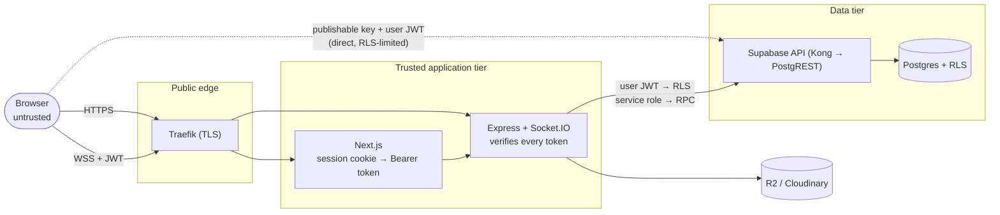

# Security

How Hibiki protects users and data, what was reviewed and fixed, how to re-verify it, and what is still open. For the underlying design see [ARCHITECTURE.md](ARCHITECTURE.md#security-model) and [DATABASE.md](DATABASE.md#row-level-security).

## Contents

- [Trust boundaries](#trust-boundaries)
- [Controls](#controls)
- [Security review, October 2026](#security-review-october-2026)
- [Automated checks](#automated-checks)
- [Residual risks and design trade-offs](#residual-risks-and-design-trade-offs)
- [Reporting a problem](#reporting-a-problem)

---

## Trust boundaries

Two things are deliberately public: the Supabase **publishable (anon) key**, which is embedded in every browser bundle, and the Supabase API URL. Security therefore **cannot depend on those being secret**. It depends on database privileges and Row Level Security, which is why most of the review below is about the database. The **service-role key** exists only in the backend's Kubernetes secret. It is not in the client, any build argument, the repository, or its history.

## Controls

| Area | Control |
|---|---|
| **Identity** | Supabase email and password auth with email confirmation. The backend verifies every REST request and every socket handshake against Supabase (`auth.getUser`), so revoked sessions stop working immediately. |
| **Authorization (data)** | Row Level Security on every table. The backend queries with the caller's own JWT wherever possible, so RLS applies to it too. |
| **Least-privilege grants** | `anon` can only read `profiles` (needed for the registration username check). `authenticated` has exactly the table operations the backend performs with a user token and nothing else (no `TRUNCATE`, no writes to rooms, participants or attachments). New tables in `public` are not granted to the API roles by default. New functions need an explicit `REVOKE ... FROM PUBLIC` (PostgreSQL grants `EXECUTE` to everyone by default), and `audit-grants.sql` flags any that are missing. |
| **Privileged operations** | Creating rooms, adding participants, accepting friendships and attaching files use `SECURITY DEFINER` functions. Their `EXECUTE` privilege is held by `service_role` only, so they cannot be called through the public API. Each backend path authenticates the caller and checks membership or admin role before using them. All are pinned to `search_path = public, pg_temp`. |
| **Data integrity in the DB** | CHECK constraints for username format, name and status length, and avatar references. Direct inserts into `messages` are limited to plain text within the length cap. Group invites can only be created by a room admin. |
| **Input validation** | Zod on socket payloads, explicit length and format checks in services, MIME allow-list **and** magic-byte verification for uploads. |
| **Uploads** | Total-size cap enforced while streaming (even without `Content-Length`), per-file, file-count and multipart-part caps, per-user and global concurrency caps, a request timeout, and an image-decoding pixel cap so a tiny file cannot expand into gigabytes of RAM. Objects are private and read through short-lived signed URLs. |
| **Rate limiting** | Pre-auth limit per real client IP, post-auth limit per user, tighter limits for search, writes and uploads, and a per-user throttle on `message:send`. The client IP is taken from `X-Forwarded-For` only when the TCP peer is a private-network address, so clients cannot spoof it. |
| **Transport** | HTTPS everywhere, with automatic Let's Encrypt certificates. HTTP redirects to HTTPS. |
| **Containers** | Non-root, read-only root filesystem, all Linux capabilities dropped, no privilege escalation, default seccomp profile, no service-account token, memory limits, health probes. |
| **Secrets** | Server secrets only in a Kubernetes secret, never in git. A history scan found no committed credentials, and the only token ever committed is the public anon key. Unused credentials are removed. |
| **Supply chain** | Images built in CI from the repository and tagged by commit SHA. Deployments are made by Argo CD from git, with self-heal. |

## Security review, October 2026

A full review of the database, backend, deployment and secrets was carried out in October 2026. Findings are grouped by class. Every fix below was exercised by the automated checks listed in the next section.

### Fixed

| # | Severity | Finding | Fix |
|---|---|---|---|
| 1 | **Critical** | Three `SECURITY DEFINER` functions that take user ids as parameters were executable by the public `anon` and `authenticated` roles, and therefore through the public API. They could be used to act as another user (accept a friendship, create a group, post a message). | Migration `20261015120000`: `EXECUTE` restricted to `service_role`; `search_path` pinned; trigger and helper functions locked down; an audit query added to catch any future function that is exposed. |
| 2 | **High** | Several RLS policies and table grants were looser than the backend's own rules: a user could add themselves to a group they were not invited to, rewrite columns of their own invite, forge friendship rows, or bypass the backend's message validation by writing to the database directly. | Migration `20261015120100`: least-privilege grants, column-level privilege on invites, stricter INSERT/UPDATE policies, and database CHECK constraints. |
| 3 | **Medium** | Rate limiting keyed on the proxy's address, so all users shared one bucket and one user could lock out everyone, and the limiter logged a misconfiguration error. | Trusted-proxy configuration, client IP forwarding from the web app, and an additional per-user limiter. Spoofing resistance is tested. |
| 4 | **Medium** | Multipart uploads were buffered in memory with no aggregate size or concurrency control. A worst-case request could hold about 250 MB, and concurrent requests multiplied that. | Streaming size cap, concurrency caps, request timeout, Multer limits on parts, and a Sharp pixel cap. |
| 5 | Low | A failure during a multi-file upload could leave objects in storage. | Cleanup now waits for all in-flight uploads to settle before deleting. |
| 6 | Low | `message:send` had no rate limit. | Per-user sliding-window throttle. |
| 7 | Low | A leftover tunnel credential remained in the cluster. | Removed. |
| 8 | Low | Pods ran with default privileges and no limits or probes. | Hardened manifests (see [DEPLOYMENT.md](DEPLOYMENT.md#kubernetes-resources)). |

### Reviewed and found sound

- Token verification on every route and on the socket handshake; sender spoofing through direct inserts into `messages` is denied by RLS.
- Outsiders cannot read a room's messages or participants, and cannot add participants or edit rooms.
- Queries built from user input use parameterised clients; the one place that interpolates an id into a filter string is only reachable with an id that has already been resolved to a real profile.
- The service-role key is confined to the server and is never imported by the web app.
- No secrets in git history.

## Automated checks

| Check | What it proves | Run |
|---|---|---|
| `supabase/tests/authorization.sql` | Abuse attempts as `anon` and as an unrelated signed-in user are denied; 13 legitimate backend flows still work. Runs in a transaction that is **always rolled back**, so it is safe against production. | `supabase/scripts/run-authz-tests.sh` |
| `supabase/scripts/audit-grants.sql` | Lists what the API roles can execute and touch; flags `SECURITY DEFINER` functions without a pinned `search_path` and tables without RLS. | see the file header |
| `server/tests/limits.test.mjs` | Trusted-proxy semantics and spoofing resistance, per-IP and per-user limits, upload size, count, type and concurrency guards, and that the server survives an aborted oversized upload. Uses a fake Supabase, so it needs no credentials. | `cd server && npm run test:limits` |

Run the database checks after every migration and before deploying code that depends on one.

## Residual risks and design trade-offs

Known and accepted for now. Each has a sketched direction in [DEPLOYMENT.md](DEPLOYMENT.md#hardening-status-and-backlog).

| Risk | Detail |
|---|---|
| Direct database writes bypass backend rate limits | Signed-in users can still insert messages, friend requests and invites straight through the Supabase API. RLS and constraints bound *what* they can write, but not *how often*. Moving those three writes behind the backend (service role) would put them under the rate limiters. |
| Profiles are world-readable | Registration needs an unauthenticated username-availability check, so `profiles` (username, display name, status, avatar reference) is readable with the public key. No email addresses are stored there. |
| Membership helper is callable | `is_room_participant` must stay executable by `authenticated` because RLS policies call it. It lets a signed-in user test whether a given user id is in a given room id, which requires knowing both random UUIDs. |
| Usernames are case-sensitive | `Alice` and `alice` can both exist, which allows look-alike accounts. A case-insensitive unique index would close this. |
| Long-lived sockets use the token captured at connect time | Access tokens last one hour. A socket opened with a token keeps using that token for its database calls and for reconnects. Based on code review, an open tab will start failing to send messages after the token expires until the page is reloaded. Refreshing the token on reconnect and per call is the fix. Not yet reproduced against production. |
| CORS allows `http://localhost:3000` in production | Harmless for bearer-token auth (no cookies are used for API calls), but unnecessary. |
| Single replica, in-memory limiters | Per-process state. Fine at this scale; see the Redis adapter item in the backlog. |
| No tests in CI | The regression checks above are run by hand. |

## Reporting a problem

This is a personal project. If you find a vulnerability, please open a private security advisory on the GitHub repository rather than a public issue.
