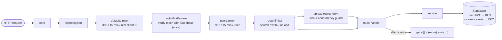

# Hibiki: Server

The backend for [Hibiki](../README.md): an Express 5 REST API and a Socket.IO server sharing one HTTP port. Supabase provides identity and the database. Cloudflare R2 stores attachments and Cloudinary stores avatars.

- **Production:** https://backend-hibiki.mrsdev.in (runs on k3s, see [Deployment](../docs/DEPLOYMENT.md))
- **Full API reference:** [docs/API.md](../docs/API.md)
- **How it fits together:** [docs/ARCHITECTURE.md](../docs/ARCHITECTURE.md)

---

## Tech stack

| | |
|---|---|
| Runtime | Node 22, TypeScript (ES modules). Run with `tsx` in development and compiled by `tsc` for production. |
| HTTP | Express 5, `cors`, `express-rate-limit` |
| Real-time | Socket.IO 4 |
| Data and auth | `@supabase/supabase-js` against a self-hosted Supabase (PostgREST + GoTrue) |
| Uploads | Multer (memory storage), `file-type` (magic-byte sniffing), Sharp (thumbnails) |
| Storage | `@aws-sdk/client-s3` with presigner for Cloudflare R2, `cloudinary` for avatars |
| Validation | Zod (socket payloads), hand-written checks in services |

## Project structure

```
server/
├── index.ts                 # Entry: creates the HTTP server, attaches Socket.IO, listens on 0.0.0.0:$PORT
├── app.ts                   # Express app: trust proxy, CORS, JSON body, limiters + auth, routers, GET /
├── config/
│   ├── supabase.ts          # Three clients: anon (token checks), per-user (RLS), service role
│   ├── cloudinary.ts        # Avatar upload + signed delivery URLs
│   └── r2.ts                # Attachment upload/delete + presigned GET URLs
├── middleware/
│   ├── auth.ts              # Bearer JWT → supabase.auth.getUser → req.userId / req.userJWT
│   ├── rateLimiter.ts       # default (IP) / user / search / write / upload limiters
│   └── uploadGuard.ts       # size cap + concurrency cap for the in-memory multipart route
├── routes/                  # Thin HTTP layer
│   ├── friendships.ts       # /api/friendships/*
│   ├── rooms.ts             # GET /api/rooms
│   ├── userMessages.ts      # GET /api/messages, POST /api/rooms/:roomId/messages
│   ├── personalUser.ts      # /api/personal/me
│   └── groups.ts            # /api/groups/*, /api/group-invites/*
├── services/                # Business logic
│   ├── room.service.ts      # Group create, invite, accept, reject, edit, roles, roster
│   ├── profile.service.ts   # Profile update, signed-avatar helpers
│   └── attachment.service.ts# File validation, R2 upload, atomic message + attachments
├── socket/
│   ├── index.ts             # initSocket(), getIo(); joins each socket to its personal room
│   ├── auth.ts              # Handshake middleware (JWT in auth.token)
│   ├── events.ts            # Registers all handlers
│   └── events/
│       ├── message.ts       # message:send
│       └── rooms.ts         # room:join, rooms:joinMany
├── tests/limits.test.mjs    # Real-server tests: IP trust/spoofing, rate limits, upload guards
├── Dockerfile               # Multi-stage build → node dist/index.js
└── tsconfig.json
```

### Request lifecycle



The real client IP comes from `X-Forwarded-For`, trusted only when the TCP peer is a private-network address (`trust proxy` in `app.ts`). Never set `trust proxy` to `true`: that lets any client choose its own IP.

Routes create a **per-request user-scoped client** with `createUserClient(req.userJWT)`, so Postgres Row Level Security applies to the caller. Operations that RLS does not permit (creating rooms, adding participants, attaching files) use `supabaseSuperUser` and are guarded by explicit checks in code first. See [Architecture → Security model](../docs/ARCHITECTURE.md#security-model).

## Environment variables

Create `server/.env` (it is git-ignored):

```env
SUPABASE_URL=https://your-supabase-host
SUPABASE_PUBLISHABLE_KEY=your-publishable-key
SUPABASE_SERVICE_ROLE_KEY=your-service-role-key
ALLOWED_ORIGIN=http://localhost:3000

CLOUDINARY_CLOUD_NAME=your-cloud
CLOUDINARY_API_KEY=your-key
CLOUDINARY_API_SECRET=your-secret

R2_ACCOUNT_ID=your-account-id
R2_ACCESS_KEY_ID=your-access-key
R2_SECRET_ACCESS_KEY=your-secret
R2_BUCKET_NAME=your-bucket

PORT=5000
```

| Variable | Description |
|---|---|
| `SUPABASE_URL` | Supabase API base URL. Production: `https://supabase.mrsdev.in`. |
| `SUPABASE_PUBLISHABLE_KEY` | Public (anon) key. Verifies tokens and backs the per-user RLS clients. |
| `SUPABASE_SERVICE_ROLE_KEY` | **Secret.** Bypasses RLS. Used for room/participant writes, RPCs, and invitee roster lookups. Never expose it. |
| `ALLOWED_ORIGIN` | Frontend origin allowed by CORS (REST and Socket.IO). Production: `https://hibiki.mrsdev.in`. `http://localhost:3000` is also always allowed for REST. |
| `CLOUDINARY_*` | Avatar upload and URL signing. |
| `R2_*` | Cloudflare R2 credentials and bucket for attachments. |
| `PORT` | Listen port. Defaults to `5000`. |

In production these come from the Kubernetes secret `hibiki-server-env`, not from a file. See [Deployment → Configuration](../docs/DEPLOYMENT.md#configuration-reference).

## Running locally

```bash
npm install
npm run dev        # tsx watch index.ts → http://localhost:5000
```

Check it is up: `curl http://localhost:5000/` → `Hibiki backend is alive`.

| Script | What it does |
|---|---|
| `npm run dev` | Run with `tsx watch`, restarting on changes |
| `npm start` | Run once with `tsx` (no compile step) |
| `npm run test:limits` | Starts the real server against a fake Supabase and checks rate limiting, IP-spoofing resistance and the upload guards (needs no credentials or `.env`) |

You need a reachable Supabase instance with the schema from [`supabase/migrations`](../supabase/migrations) applied, plus R2 and Cloudinary credentials, because attachments and avatars have no local fallback.

## Docker

```bash
docker build -t hibiki-server ./server
docker run --rm -p 5000:5000 --env-file server/.env hibiki-server
```

The image has two stages: it compiles TypeScript with `tsc --outDir dist` in the first, then installs production dependencies only and runs `node dist/index.js` as the unprivileged `node` user in the second. CI builds it for `linux/arm64`. See [Deployment → CI/CD](../docs/DEPLOYMENT.md#cicd-pipeline).

## API and events at a glance

Complete request and response shapes are in [docs/API.md](../docs/API.md). In short:

- **REST** (all under `/api`, Bearer token required): friendships (search, pending, request, accept, reject), rooms, paginated messages, message upload, own profile, groups (create, search, edit, invite, roles), group invites (pending, accept, reject).
- **Socket.IO** client → server: `room:join`, `rooms:joinMany`, `message:send`.
- **Socket.IO** server → client: `message:new`, `message:error`, `room:joined`, `room:unauthorized`, `room:error`, `friendship:requested`, `friendship:got_a_request`, `friendship:accepted`, `friendship:rejected`, `group:invited`, `group:joined`, `group:memberJoined`, `room:updated`.

Connect a socket with the Supabase access token in the handshake:

```js
const socket = io('https://backend-hibiki.mrsdev.in', {
  withCredentials: true,
  auth: { token: supabaseAccessToken },
});
```
